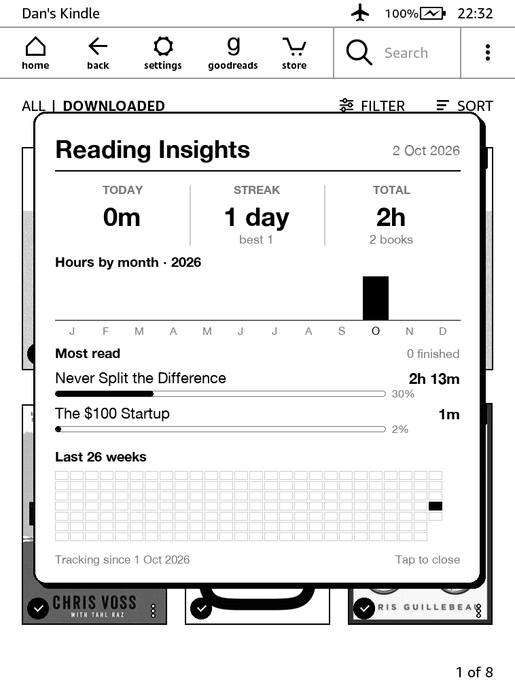
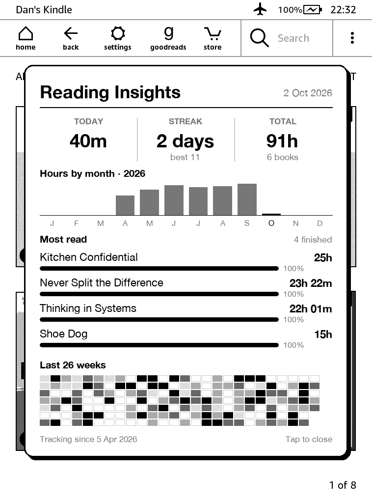

# InkSights

A Steam-style reading stats card for jailbroken Kindles, for books read in
the stock Kindle reader. Tap **InkSights** in your Library and a card
pops up over it:

- **Today**, your **streak** (days with 5+ minutes) and **total** reading time
- **Hours by month** for the current year
- **Most read** books with time spent and progress
- A **26-week heatmap** of your reading days

  
  &nbsp;
  

Left: two days in. Right: six months of demo data. (Previews; on the Kindle the card uses its Amazon Ember font.)

Tap anywhere to close it; putting the Kindle to sleep closes it too. On
firmware 5.18 the card has the screen to itself and the Library comes back
when you close it.

The numbers come from the Kindle's own reading timer and library database.
Kindle system files are only ever **read**, never changed.

## Requirements

- A **jailbroken Kindle on firmware 5.16.3 or newer** (the "hard-float"
  firmware), with Scriptlet support: `.sh` files in `documents` show up in
  the Library. Modern jailbreaks (WinterBreak, SpiderCat, AdBreak and the
  like) set this up for you.
- **FBInk**, which modern jailbreaks install too (InkSights looks for it in
  the usual places).
- Books read in the **stock Kindle reader** (KOReader keeps its own stats).

Tested on a Kindle 11th gen (2022), FW 5.18.1. Nothing else to install:
InkSights is a single program.

**Older Kindle?** (firmware before 5.16.3, e.g. a Paperwhite 2 on 5.12) Use
[InkSights v1.2.0](../../releases/tag/v1.2.0), the Python version. It needs
NiLuJe's Python 3 and is no longer being developed. Your `reading-stats/`
folder works with both, so you can move it to a newer Kindle.

## Install

Unzip `inksights-<version>.zip` from the
[latest release](../../releases/latest) and copy its `extensions` and
`documents` folders onto the Kindle's USB drive (merge with what's there).
Eject, and **InkSights** appears in your Library.

**Moving from another Kindle?** Copy its `reading-stats/` folder to the root
of the new Kindle before you open InkSights the first time, and your log,
streaks and totals carry on.

### Uninstall

Delete `documents/InkSights.sh` and `extensions/inksights/`. Your reading log
is in `reading-stats/`: keep it if you might come back.

## How the numbers work

The Kindle keeps a running total of reading time per book in each book's
sidecar folder (`<book>.sdr`), but no dates. Each time you open InkSights it
compares those totals with the last ones it saw and logs the difference.
Streaks, the heatmap and the month chart come from that log
(`reading-stats/snapshots.jsonl`).

To put that time on the right days, InkSights records when the Kindle wakes
and sleeps (and which book is open when it sleeps): the screen is only on
while you're reading, and it sleeps a few minutes after you put it down. Time
gained between two launches is split across days by how long the screen was
on each day. Time asleep inside a different book, and Desk Buddy sessions,
don't count. The recorder is a tiny background script started the first
time you open InkSights after the Kindle restarts; it writes
`reading-stats/activity.log`. If you use
[CoverSleep](https://github.com/dq-stack/CoverSleep), its log is used too, for
any stretch the recorder wasn't running. With neither, the time goes on the
day you open InkSights. So:

- history starts when you first open InkSights (time read before then
  counts toward totals but isn't dated);
- after a restart, open InkSights once so the recorder runs (your reading
  time is still counted either way; only the split by day needs it);
- re-sending a book from Calibre can reset its sidecar, but the hours already
  logged are kept;
- progress (%) is the Kindle's own figure, the same as the badge on the cover.

The card is never shown with out-of-date numbers: a saved copy is only reused
when nothing it was made from has changed.

## Backing up

Everything InkSights knows lives in **one folder on the Kindle:
`reading-stats/`** (visible over USB):

| | |
|---|---|
| `snapshots.jsonl` | your reading log: every bit of reading time, by day and book |
| `activity.log` | when the Kindle woke and slept, used to split reading time by day |
| `sidecars/` | copies of each book's sidecar files (position, highlights, timer), refreshed whenever your reading data changes |
| `stats.log` | what the app did, for troubleshooting |

`sidecars/` keeps copies even after a book's own sidecar is deleted (for
example by a Calibre re-send), so a book's position and highlights can be
put back.

**To back up:** copy the `reading-stats` folder to your computer now and then.

**After a factory reset or wipe:** reinstall InkSights, then copy your
backed-up `reading-stats` folder back to the root of the Kindle. Your log,
streaks and totals carry on from where they were.

**To restore one book's position/highlights:** copy its folder from
`reading-stats/sidecars/` back to the same place under `documents/`, before
opening the book. This is only safe if the book file itself hasn't changed
(a re-converted book may not line up).

### Automatic backups with calibre

If you manage your books with [calibre](https://calibre-ebook.com) (6.18 or
newer), the **InkSights Backup** plugin backs up your reading data every
time the Kindle connects:

- each book's reading data (position, highlights, reading timer) is saved in
  that book's **data files** in your calibre library (right-click a book >
  Manage data files > `kindle-reading/`), so it moves with the book and is
  included in any backup of your library;
- the InkSights log is copied to calibre's settings folder
  (`plugins/InkSights Backup/reading-stats/<date>/`), newest 30 kept.

It works with the Kindle connected by USB, or over Wi-Fi through
[Calibre Wireless](https://github.com/dq-stack/CalibreWireless) 1.1.0 or newer.

It only reads from the Kindle. Install `inksights-backup-calibre-<version>.zip` from the
release: calibre > Preferences > Plugins > Load plugin from file. Runs by
itself; there's also a **InkSights Backup** button (add it under
Preferences > Toolbars & menus) to run it on demand.

To restore a book's reading data, open its data files in calibre and copy the
files from `kindle-reading/` into that book's `.sdr` folder on the Kindle
(same caveat as above: only if the book file hasn't changed).

## Development

- `app/`: the Kindle app in Go (`cmd/inksights` is the program,
  `internal/` the parts); `calibre-plugin/`: the calibre plugin;
  `packaging/`: the Library tile and the wake/sleep recorder
- Needs **Go 1.23** (1.24 and later dropped the older Linux kernels some
  Kindles run). `cd app && go test ./...` runs the tests;
  `calibre-debug -e tests/calibre_core_check.py` tests the plugin core
- `tools/deploy.sh` builds the checkout and copies it to a Kindle over USB,
  or over SSH with `KINDLE_SSH=root@<ip>`; `tools/package.sh <version>`
  builds the release downloads (CI does this when a `v*` tag is pushed)
- The program has a few helper commands besides showing the card:
  - `inksights probe` (on the Kindle): what it finds (screen, FBInk, Library
    window, touchscreen); handy for bug reports
  - `inksights dump` (on the Kindle or on a copy of its files): the books,
    log rows and stats one launch would produce, as JSON, without writing
    anything
  - `inksights render` (on a computer): draws the card from a reading log
    into a PNG

## Licence and credits

GPLv3 (see `LICENSE`). The sidecar decoder (`app/internal/krds`) follows
John Howell's GPLv3 Kindle reader data store decoder, as patched in
[zevisvei/kindle-reading-dashboard](https://github.com/zevisvei/kindle-reading-dashboard).

- [K-R-D-S](https://github.com/K-R-D-S/KRDS): the file format notes
- Card design inspired by the KOReader patches of
  [quanganhdo](https://github.com/quanganhdo/koreader-user-patches) and
  [zenixlabs](https://github.com/zenixlabs/koreader-frankenpatches-public)
- Drawing via [FBInk](https://github.com/NiLuJe/FBInk), or straight
  through X on firmware 5.18
